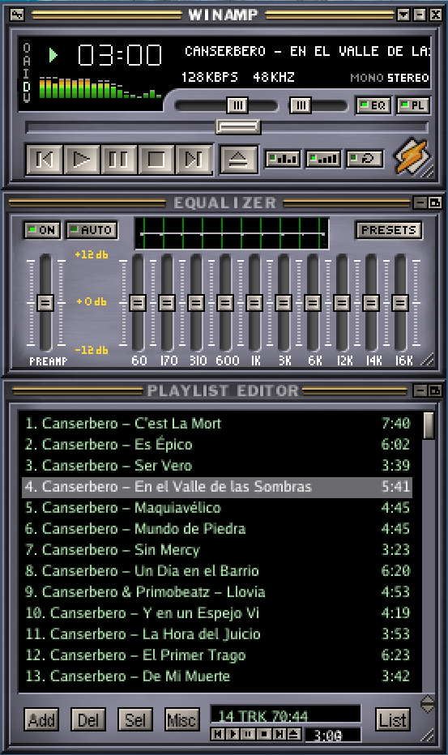
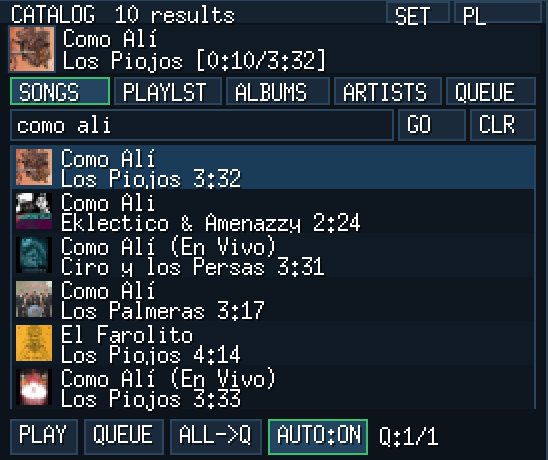
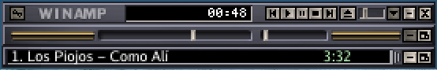
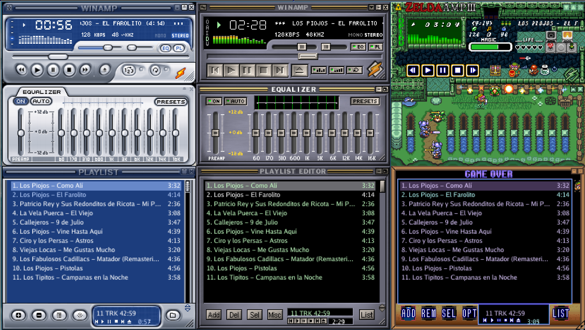
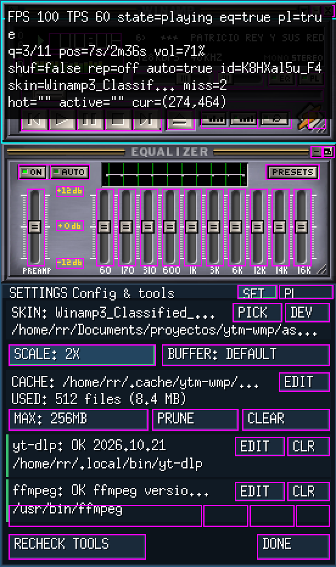
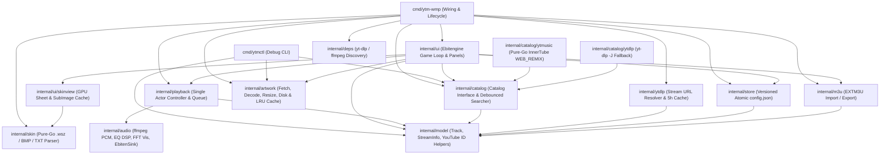
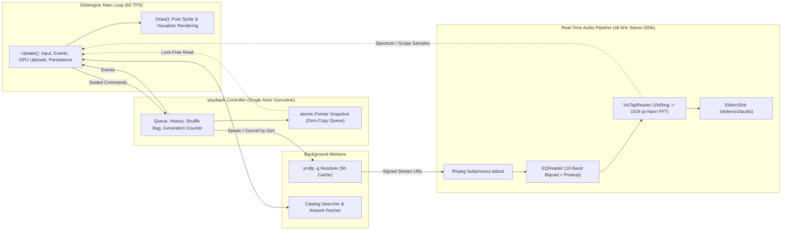
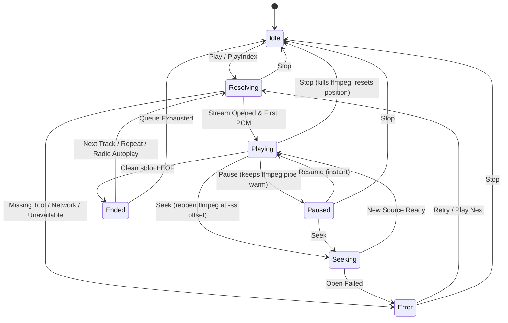

# ytm-wmp

A lightweight, Linux-native YouTube Music desktop player with classic Winamp 2.x (`.wsz`) skin support, written in Go.


-FCC624?logo=linux&logoColor=black)


---

## Table of Contents

- [Features](#features)
- [Screenshots & Media](#screenshots--media)
- [Quick Start](#quick-start)
- [CLI Usage & Flags](#cli-usage--flags)
- [Controls & Shortcuts](#controls--shortcuts)
- [Architecture](#architecture)
- [Key Architectural Decisions](#key-architectural-decisions)
- [Project Structure](#project-structure)
- [Roadmap & Scope](#roadmap--scope)
- [Development & Testing](#development--testing)
- [Acknowledgments](#acknowledgments)
- [License & Legal Notice](#license--legal-notice)

---

## Features

### Classic Winamp 2.x Skin Engine
- **Pure-Go `.wsz` / `.zip` / loose BMP loader** with full classic sprite mapping, `pledit.txt` styling, `viscolor.txt` palettes, and bitmap `text.bmp` font rendering (with TTF fallback for Unicode track titles).
- **Docked Winamp rack** inside a single OS window: Main (`275×116`), toggleable Equalizer (`275×116`), and toggleable Playlist / Catalog Browser (`275×232`).
- **WindowShade mode** (`14px` collapsed bars with mini transport/seek and mini volume/balance) for Main, EQ, and Playlist.
- **Hot-reloadable skins** via the main window `SK` button (OS file picker) or `-skin` flag, plus `1.0x`–`2.0x` scaling (`D` / `Ctrl+D` double-size toggle).
- **Bundled original dev skin** (`assets/dev-skin/`) so the player works out of the box with zero copyrighted assets.

### YouTube Music & Catalog
- **Pure-Go YouTube Music InnerTube (`WEB_REMIX`) backend** (default) for fast searching across **Songs, Playlists, Albums, and Artists**, with album/artist/playlist detail drill-down.
- **Fallback `yt-dlp` catalog** (`-catalog ytdlp`, or prefix any search with `yt:` / `ytdlp:` to search regular YouTube videos).
- **Unauthenticated Up Next Radio autoplay** (`RDAMVM...`) that automatically queues related tracks when the queue ends.
- **M3U / M3U8 playlist import & export** alongside direct YouTube watch/playlist URL pasting.
- **Asynchronous artwork pipeline** (JPEG/PNG/WebP decoding, `64×64` list and `300×300` preview resizing, disk + in-memory LRU caching).

### Audio & DSP
- **Low-latency `ffmpeg` PCM pipe** (`f32le`, 48 kHz stereo) into `ebiten/v2/audio` with 5-hour stream URL caching, next-track prefetching, and automatic stale-URL retry.
- **Live 10-band peaking biquad Equalizer + preamp** wired directly into the audio pipeline with bypass, clipping protection, presets, and `eq.json` persistence.
- **Real-time `viscolor.txt` Visualizer** powered by a 1024-point Hann-windowed FFT (click the visualizer box to cycle **Spectrum → Oscilloscope → Off**).

### Player UX & Persistence
- **Versioned, atomic `config.json` persistence**: restores skin, volume, balance, queue, window visibility/shade states, scale, audio buffer size, artwork cache limits, tool paths, and last search on startup.
- **In-app Settings panel (`SET` / `F2`)** for configuring skin, scale, audio buffer, artwork cache stats/pruning, and custom `yt-dlp`/`ffmpeg` binary paths.
- **Actionable dependency & error toasts** — if `yt-dlp` or `ffmpeg` is missing from `PATH`, the player still opens and lets you point to custom binary paths directly in Settings.
- **Companion `ytmctl` CLI** for testing search, track metadata, playlists, radio, and artwork from the terminal.

---

## Screenshots & Media

| View | Preview |
|---|---|
| **Full Winamp Rack (Main + EQ + Playlist)**<br>Showing classic chrome, active spectrum visualizer, 10-band EQ graph, and skinned playlist editor. |  |
| **Catalog Browser & Artwork Preview**<br>Searching YouTube Music across Songs / Playlists / Albums / Artists with `300×300` now-playing artwork. |  |
| **WindowShade & 2X Scale**<br>Collapsed `14px` shade bars with mini transport/seek controls and double-size scaling. |  |
| **Custom `.wsz` Skin Showcase**<br>Hot-reloading community `.wsz` skins via the `SK` picker (e.g. from the Winamp Skin Museum). |  |
| **Settings Panel & `F1` Debug Overlay**<br>In-app configuration (`F2`) and sprite/hitbox diagnostics (`F1`). |  |

---

## Quick Start

### Prerequisites

- **OS**: Linux desktop (X11 or Wayland with OpenGL; Windows and macOS are out of scope).
- **Go**: `1.27+` (matching [`go.mod`](go.mod)).
- **Runtime tools**:
  - [`yt-dlp`](https://github.com/yt-dlp/yt-dlp#installation) on `PATH` (or configured in Settings)
  - [`ffmpeg`](https://ffmpeg.org/download.html) on `PATH` (or configured in Settings)
- **Build libraries** (Ebitengine uses Cgo on Linux):
  - **Debian / Ubuntu**:
    ```sh
    sudo apt install libx11-dev libxcursor-dev libxrandr-dev libxinerama-dev \
      libxi-dev libxrender-dev libgl1-mesa-dev
    ```
  - **Fedora / Arch**: install the equivalent `libX11`, `libXcursor`, `libXrandr`, `libXinerama`, `libXi`, `libXrender`, and Mesa GL development packages.

### Build & Run

```sh
git clone https://github.com/rroy-ar/ytm-wmp.git
cd ytm-wmp

# Run directly with the bundled dev skin
go run ./cmd/ytm-wmp

# Or build binaries
go build -o ytm-wmp ./cmd/ytm-wmp
go build -o ytmctl ./cmd/ytmctl
./ytm-wmp
```

### Using Classic `.wsz` Skins

You can grab classic Winamp 2.x `.wsz` skins from the [Winamp Skin Museum](https://skins.webamp.org/) and load them in two ways:

1. **In-app**: Click the `SK` button (to the right of `REP` on the main window) to open your OS file picker and hot-reload any `.wsz` or `.zip` skin.
2. **CLI**: Pass `-skin /path/to/skin.wsz` (or a directory of loose BMPs).

> **Note:** Modern Winamp 3/5 `.wal` skins (`skin.xml`) are detected and rejected with a clear message.

---

## CLI Usage & Flags

### `ytm-wmp`

```sh
# Load a classic .wsz skin (or directory of loose BMPs)
go run ./cmd/ytm-wmp -skin /path/to/skin.wsz

# Launch with an initial YouTube Music search
go run ./cmd/ytm-wmp -query 'daft punk'

# Load a YouTube / YouTube Music playlist, album, or local .m3u/.m3u8 file
go run ./cmd/ytm-wmp -playlist 'https://music.youtube.com/playlist?list=...'

# Queue specific video IDs, watch URLs, or search queries
go run ./cmd/ytm-wmp -url 'https://www.youtube.com/watch?v=...' -url '0wRYvsfhsR8'

# Use yt-dlp for catalog search instead of InnerTube WEB_REMIX
go run ./cmd/ytm-wmp -catalog ytdlp -query 'daft punk'

# Disable Up Next radio autoplay and enable debug logging
go run ./cmd/ytm-wmp -autoplay=false -debug
```

| Flag | Default | Description |
|---|---|---|
| `-skin` | `assets/dev-skin` | Path to a `.wsz`, `.zip`, or directory of loose BMPs |
| `-catalog` | `ytmusic` | Catalog backend: `ytmusic` (pure-Go InnerTube) or `ytdlp` |
| `-query` | *(empty)* | Run an initial catalog search on startup |
| `-playlist` | *(empty)* | Load a YouTube/YTM playlist/album URL/ID or local `.m3u`/`.m3u8` |
| `-url` | *(demo track)* | Repeatable video ID, watch URL, or search query for the initial queue (also accepts positional args) |
| `-autoplay` | `true` | Automatically queue YouTube Music Up Next radio tracks when the queue ends |
| `-debug` | `false` | Enable verbose debug logging |

> **Tip:** Even with `-catalog ytmusic`, prefixing any search query in the UI with `yt:` or `ytdlp:` routes that query to regular YouTube via `yt-dlp` for videos not indexed on YouTube Music.

### `ytmctl` (Companion Debug CLI)

```sh
go run ./cmd/ytmctl search -limit 10 "daft punk"
go run ./cmd/ytmctl -catalog ytdlp search -limit 10 "daft punk"
go run ./cmd/ytmctl track 0wRYvsfhsR8
go run ./cmd/ytmctl playlist -limit 20 "PL..."
go run ./cmd/ytmctl radio -limit 20 0wRYvsfhsR8
go run ./cmd/ytmctl artwork 0wRYvsfhsR8
```

---

## Controls & Shortcuts

### Keyboard Shortcuts

| Category | Keys | Action |
|---|---|---|
| **Playback** | `Space` | Play / Pause |
| | `S` | Stop |
| | `Z` / `B` | Previous / Next track |
| | `Left` / `Right` | Seek ±5 seconds |
| | `Up` / `Down` | Volume ±10% (or navigate results while searching) |
| | `H` | Toggle Shuffle |
| | `R` | Cycle Repeat (`off` → `all` → `one`) |
| | `A` | Toggle Up Next Radio Autoplay |
| **Windows & UI** | `E` | Toggle Equalizer window |
| | `P` | Toggle Playlist / Browser panel |
| | `Ctrl+D` | Toggle Double-Size (`1X` ↔ `2X`) |
| | `F2` | Toggle Settings panel |
| | `F1` | Toggle Debug overlay (FPS, state, sprite & hitbox rects) |
| **Search & Playlist** | `/` | Focus search bar (supports caret movement & IME input) |
| | `Enter` | Submit search |
| | `Ctrl+V` / `Super+V` / `Shift+Insert` | Paste into search (or import M3U/URLs when Playlist is focused) |
| | `Ctrl+U` / `Ctrl+Backspace` | Clear search while focused |
| | `Ctrl+A` / `Delete` | Select all / remove selected playlist rows |
| | `Esc` | Unfocus search, dismiss active toast/modal, or close catalog |

### Mouse Interactions

- **Main Window**: Transport buttons (`Prev`, `Play`, `Pause`, `Stop`, `Next`, `Eject` to open search), click time display to toggle elapsed/remaining, volume/balance/seek sliders, `SHUF`/`REP`/`EQ`/`PL` toggles, clutter-bar `D` (`1X`/`2X`), `SK` skin picker, click visualizer box to cycle modes, shade button or titlebar double-click for WindowShade.
- **Equalizer**: `ON`, `AUTO`, `PRESETS`, `+12dB`/`0dB`/`-12dB` reset points, preamp + 10-band sliders, shade mode with mini volume/balance.
- **Playlist & Browser**: Click / `Ctrl+Click` / `Shift+Click` selection, double-click to play or drill into collections (`<BACK`), right-click search results to enqueue, `ADD`/`REM`/`SEL`/`MISC`/`LIST` popup menus (including M3U save/load), middle/right-click search box to paste, and `SONGS` / `PLAYLST` / `ALBUMS` / `ARTISTS` / `QUEUE` tabs.

---

## Architecture

### Package & Dependency Graph

Dependencies are strictly one-way. Core packages (`skin`, `artwork`, `store`, `m3u`, `catalog`) have zero Ebitengine imports, making them fast to test and fuzz completely headless.



### Runtime, Concurrency & Audio Pipeline

`Draw()` is strictly pure — no network calls, subprocesses, disk I/O, or GPU texture creation ever happen during rendering. The UI communicates with the single `playback.Controller` actor via sealed commands, events, and a lock-free atomic snapshot.



### Playback State Machine



---

## Key Architectural Decisions

Architectural Decision Records live in [`docs/adr/`](docs/adr/). Summary of the core trade-offs:

| Area | Decision | Why |
|---|---|---|
| **Audio Backend** ([ADR 0001](docs/adr/0001-audio-backend.md)) | `ebiten/v2/audio` consuming `f32le` 48 kHz stereo PCM from `ffmpeg` | Avoids fighting over two audio stacks (`beep`/`oto` + Ebitengine). Pausing keeps the pipe warm for instant resume; seeking reopens `ffmpeg` at `-ss` cleanly since stdout pipes aren't seekable. |
| **Window Model** ([ADR 0002](docs/adr/0002-single-window-model.md)) | Single OS window with a docked/stacked Winamp rack | Ebitengine owns one OS window per process. Resizing only on discrete panel/shade/scale toggles avoids X11/Wayland compositor flicker and keeps hit-testing simple and deterministic. |
| **Concurrency & Catalog Split** ([ADR 0003](docs/adr/0003-playback-actor-and-catalog-split.md)) | Single playback actor + separate `catalog` and `ytdlp` packages | Eliminates scattered locks and deadlocks during audio teardown. Isolates YouTube signature/format churn (`yt-dlp -g`) from fast catalog browsing (InnerTube `WEB_REMIX`). |
| **Skin Parser** | Pure-Go `internal/skin` with zero GPU imports | Allows fast offline unit tests and `FuzzSkinOpen` fuzzing over untrusted `.wsz` archives with strict byte, pixel, and ZIP-entry caps. |
| **UI Architecture** | Immediate-mode hit testing (`Pointer`) | Classic Winamp chrome consists of fixed sprite rects with a handful of states; a retained UI framework would add complexity without benefit. |
| **Persistence** | Versioned JSON (`config.json`, `eq.json`) with atomic temp-file rename + 500 ms debounce | Config and queue metadata are small; SQLite is unnecessary. Signed stream URLs are never persisted to disk. |
| **External Tools** | Require system `yt-dlp` and `ffmpeg` | Keeps the binary small and avoids bundling/auto-updating rapidly changing extractors. Startup checks surface actionable in-app guidance. |

---

## Project Structure

```text
cmd/
├── ytm-wmp/               # Desktop player entrypoint (flags, deps check, wiring, signals)
└── ytmctl/                # Terminal CLI for catalog search, track, playlist, radio & artwork
internal/
├── model/                 # Shared domain types (Track, StreamInfo) and YouTube ID helpers
├── deps/                  # Startup discovery and version checks for yt-dlp and ffmpeg
├── ytdlp/                 # yt-dlp -g stream resolver, bounded output, 5-hour URL cache
├── catalog/               # Catalog / TabCatalog / RadioProvider interfaces & debounced Searcher
│   ├── ytmusic/           # Pure-Go YouTube Music InnerTube WEB_REMIX backend
│   └── ytdlp/             # yt-dlp -J catalog fallback backend
├── artwork/               # Thumbnail fetch, JPEG/PNG/WebP decode, resize, disk + LRU cache
├── audio/                 # ffmpeg PCM source, 10-band biquad EQ, FFT visualizer tap, EbitenSink
├── playback/              # Single-actor Controller, state machine, queue, shuffle/repeat, radio
├── skin/                  # Pure-Go .wsz/.zip/dir skin parser, sprite table, pledit/viscolor
├── store/                 # Versioned atomic config.json persistence, migration, debounced saver
├── m3u/                   # #EXTM3U playlist parser and formatter
└── ui/                    # Ebitengine Game loop, immediate-mode input, docked panels & toasts
    └── skinview/          # One-time GPU sheet upload and SubImage / glyph / slider caches
assets/
└── dev-skin/              # Original classic-dimension BMPs (no copyrighted skins)
docs/
├── adr/                   # Architecture Decision Records (0001–0003)
└── plan/                  # Detailed design & execution plan
```

---

## Roadmap & Scope

### Ready Today
- Full classic Winamp 2.x `.wsz` skin rendering (Main, Equalizer, Playlist, WindowShade, `1X`–`2X` scaling, hot-reload).
- Pure-Go YouTube Music InnerTube catalog (Songs, Playlists, Albums, Artists, Up Next Radio) + `yt-dlp` fallback.
- Live 10-band biquad EQ DSP and `viscolor.txt` Spectrum / Oscilloscope visualizer.
- Multi-track queue with shuffle bag, repeat modes, history, M3U import/export, and atomic `config.json` persistence.

### Planned
- [ ] `region.txt` polygon window masks for irregularly shaped classic skins.
- [ ] Custom `.cur` cursor support.
- [ ] Optional Linux desktop integration (MPRIS / media keys) and gapless playback.
- [ ] Performance profiling, Linux CI, packaging, and `v0.1` release.

### Explicit Non-Goals
- **Windows / macOS support** — targeted strictly at Linux (X11 / Wayland).
- **Modern `.wal` skins** (XML + Maki scripting) — classic 2.x `.wsz` skins only.
- **Video playback, AVS/MilkDrop, CD ripping, or account/cookie sync** — focused on fast, unauthenticated public catalog playback.

---

## Development & Testing

All unit tests run offline with fakes (no `yt-dlp`, `ffmpeg`, or network required):

```sh
gofmt -l .
go vet ./...
go build ./...
go test ./...
go test -race ./...
```

Live integration tests against YouTube / YouTube Music are opt-in:

```sh
YTM_LIVE=1 go test ./internal/catalog/ytmusic/...
```

Press **`F1`** while running `ytm-wmp` to toggle the built-in debug overlay (FPS/TPS, playback state, queue index, active skin, missing sprite count, cyan sprite bounds, and magenta hitboxes). Missing sprites render as labelled magenta placeholders.

---

## Acknowledgments

- Classic Winamp 2.x sprite coordinates, `text.bmp` character lookup tables, and default color tables are derived from [Webamp (`captbaritone/webamp`)](https://github.com/captbaritone/webamp) (MIT License). See [`THIRD_PARTY_NOTICES.md`](THIRD_PARTY_NOTICES.md).
- Built with [Ebitengine](https://ebitengine.org/), [`yt-dlp`](https://github.com/yt-dlp/yt-dlp), and [`ffmpeg`](https://ffmpeg.org/).

---

## License & Legal Notice

This project is licensed under the [MIT License](LICENSE).

### Disclaimer
- **No Bundled Skins or Media:** This repository contains only original placeholder skin assets (`assets/dev-skin/`) created for development and testing. No copyrighted Winamp skins, audio streams, or media files are distributed with this software.
- **Third-Party Services:** `ytm-wmp` is an independent desktop client and is not affiliated with, endorsed by, or connected to Google, YouTube, or Winamp. Users are responsible for complying with the Terms of Service of YouTube and any external tools (`yt-dlp`, `ffmpeg`) invoked by the application.
